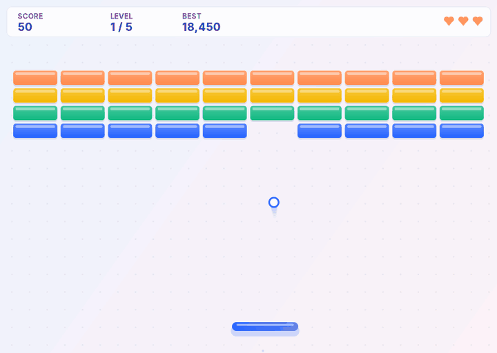
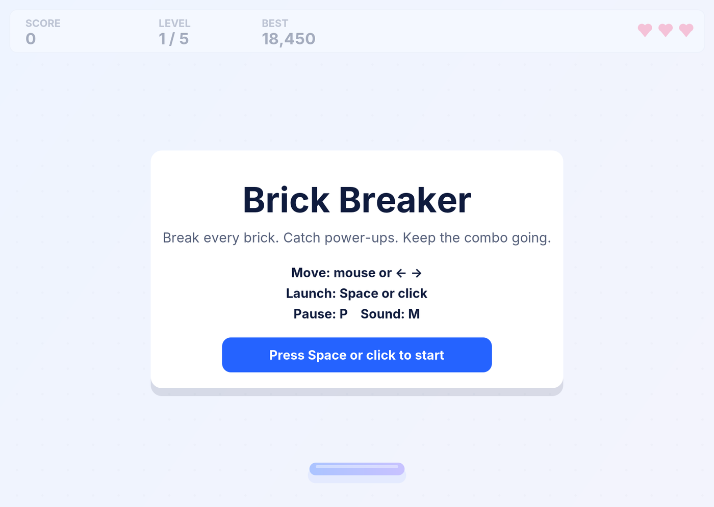
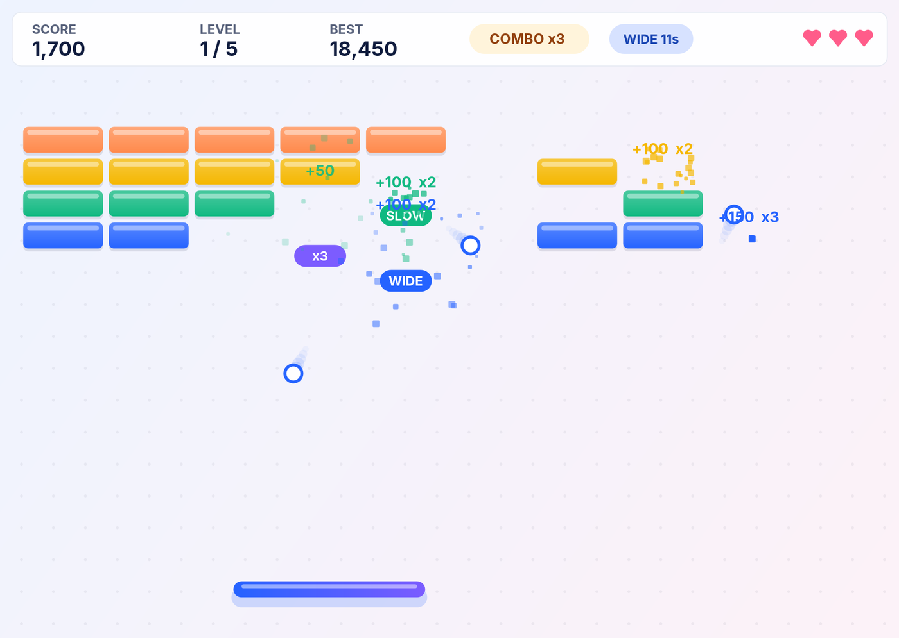
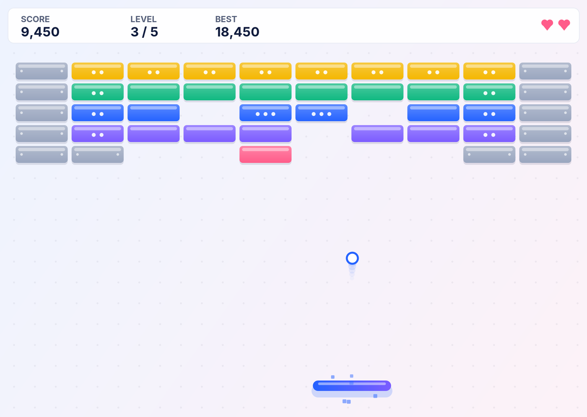
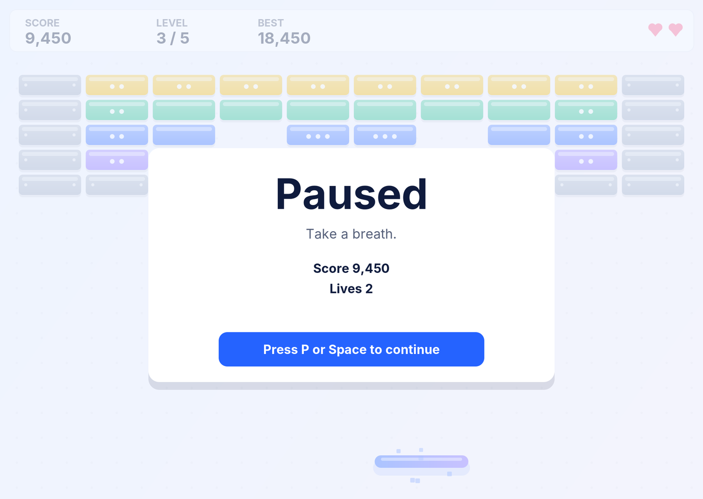

<div align="center">

# 🧱 Brick Breaker — Java Swing Arcade Game

**A polished 2D arcade game in pure Java: real collision physics, 5 levels, power-ups, combos, particles and sound, with no external libraries.**

[](https://github.com/DevRisny/Pynexia_Java_Brick_Breaker/actions/workflows/ci.yml)




</div>

---

## 🎮 Play

**Option 1, one click:** download [`BrickBreaker.jar`](BrickBreaker.jar) and double-click it, or run `java -jar BrickBreaker.jar` (Java 17 or newer).

**Option 2, from source:**

```bash
git clone https://github.com/DevRisny/Pynexia_Java_Brick_Breaker.git
cd Pynexia_Java_Brick_Breaker
./run.sh          # Windows: run.bat
```

| Control | Action |
|---|---|
| Mouse or ← → / A D | Move the paddle |
| Space, Enter or click | Start, launch the ball, continue |
| P or Esc | Pause / resume |
| M | Sound on / off |

## ✨ Features

| | |
|---|---|
| 🧮 **Real collision physics** | Circle-vs-rectangle tests with push-out normals, corner hits, and sub-stepping so a fast ball never passes through a brick. |
| 🎯 **Skill-based paddle** | Where the ball lands on the paddle sets its angle (up to 60°); a minimum vertical speed stops endless flat rallies. |
| 🗺️ **5 handmade levels** | Warm-up, Pyramid, Fortress, Diamond and Final wall, written as text maps. |
| 🧱 **4 brick types** | Normal (1 hit), Strong (2), Tough (3, shows cracks and remaining hits), Steel (unbreakable). |
| ⚡ **Power-ups** | Wide paddle (12 s), Multi-ball (×3), Slow ball (8 s), Extra life, with live timers in the HUD. |
| 🔥 **Combo scoring** | Every 3 bricks without touching the paddle raises the multiplier, up to ×5, with floating score popups. |
| ✨ **Game feel** | Particle bursts, hit flashes, screen shake, ball trail, smooth paddle easing. |
| 🔊 **Synthesised sound** | Nine effects generated in code, no audio files; runs silently on machines without audio. |
| 🏆 **High score** | Saved to `~/.brickbreaker/highscore`; the game never crashes if saving fails. |
| 🖥️ **Any window size** | Fixed 120 Hz physics step (same speed on every PC) and resolution-independent scaling. |

<table>
<tr>
<td width="50%"><br><sub><b>Start menu</b> with controls.</sub></td>
<td width="50%"><br><sub><b>Multi-ball</b> and a ×3 combo.</sub></td>
</tr>
<tr>
<td width="50%"><br><sub><b>Level 3 · Fortress</b>: steel walls and tough bricks.</sub></td>
<td width="50%"><br><sub><b>Pause</b> screen.</sub></td>
</tr>
</table>

## 🧪 Tests

```bash
javac --release 17 -d out $(find src test -name "*.java")
java -Djava.awt.headless=true -cp out com.risny.brickbreaker.GameTests
```

22 tests, written with a tiny built-in runner so nothing has to be downloaded:

- **Physics:** misses, top/corner/inside hits and their normals, reflection, paddle angles at the centre and edge, minimum vertical speed, sub-step counts, combo maths.
- **Game rules:** level maps are valid and in bounds, new game state, launch, losing a life, pause freezes time, the ball never escapes the play area over a 30-second simulation, multi-ball, wide paddle expiry, steel bricks, high-score saving.
- **End to end:** an autopilot plays level 1 in a headless simulation and clears it.

CI compiles with `-Xlint:all -Werror` (zero warnings) and runs the tests on every push.

## 🏗️ Architecture

```
src/com/risny/brickbreaker/
├── BrickBreaker.java   entry point; Swing panel, input, fixed-timestep loop, scaling
├── World.java          all game state and rules (no Swing → testable and headless)
├── Physics.java        pure collision and bounce maths
├── Entities.java       Ball, Paddle, Brick, PowerUp, Particle, Popup
├── Levels.java         text-map levels and colours
├── Renderer.java       draws the World on any Graphics2D
├── Sound.java          synthesised effects with a silent fallback
└── HighScores.java     safe high-score persistence
test/…/GameTests.java   22 tests
tools/…/Capture.java    headless screenshots and GIF frames for this README
```

The **model / view split** is the key design choice: `World` knows nothing about Swing, so the same code runs in the window, in tests, and in the headless capture tool that produced every image on this page.

**OOP concepts shown:** encapsulation (state behind `World`), enums with data (`BrickType`, `PowerType`), records (`Physics.Hit`), pure static utilities, the state pattern (`MENU → READY → PLAYING → PAUSED → LEVEL_CLEAR → GAME_OVER / WON`), and dependency injection (`Sound`, random seed and high score passed into `World`).

---

<div align="center">

Built by **Junaideen Risny Suha** for the **Pynexia Java Programming Internship**, Week 2 (2D Arcade Game Physics & Desktop Utilities).

[LinkedIn](https://linkedin.com/in/risny-suha-8a6b66423) · [GitHub](https://github.com/DevRisny)

</div>
